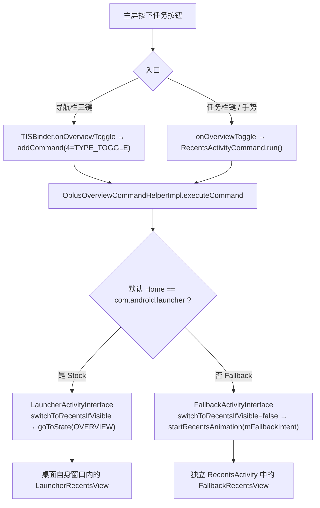

# 第三方桌面 vs 默认桌面：最近任务列表与动画差异

- 分析对象：`com.android.launcher`（apktool 反编译工程），versionName `16.4.5` / versionCode `160040005`
- 原始工程：`/storage/emulated/0/MT2/apks/系统桌面_16.4.5_src/`，代码位于 `smali`、`smali_classes2` ~ `smali_classes7`
- 主题：在**主屏**按下任务按钮时，第三方桌面作为默认 Home（Fallback 分支）与系统桌面作为默认 Home（Stock 分支）在**任务列表**与**动画**上的区别
- 标注：**实证** = 反编译代码中确有此分支/调用/常量；**推断** = 由代码路径推导出的运行时后果
- 相关文档：任务按钮的完整事件链见 [`reverse-engineering.md`](reverse-engineering.md) 第 2 节；应用内打开最近任务的触摸/闪烁问题见 [`recents-open-from-app.md`](recents-open-from-app.md)

---

## 目录

- [0. 结论摘要](#0-结论摘要)
- [1. 分叉的根：默认 Home 判定](#1-分叉的根默认-home-判定)
- [2. 任务按钮入口（简述）](#2-任务按钮入口简述)
- [3. 任务列表差异](#3-任务列表差异)
- [4. 动画差异](#4-动画差异)
- [5. 第三方桌面触发的系统级联动](#5-第三方桌面触发的系统级联动)
- [6. 对照总表](#6-对照总表)
- [7. 证据索引](#7-证据索引)

---

## 0. 结论摘要

1. **“第三方桌面”不改变「谁渲染最近任务」**：最近任务始终由系统桌面包内的 `TouchInteractionService` 与 `RecentsActivity` 提供（二者均在本包内，见 `AndroidManifest.xml`），第三方桌面仅作为 Home 存在。它改变的是**分支**：`OverviewComponentObserver` 依据“默认 Home 是否为本包”在 `LauncherActivityInterface` 与 `FallbackActivityInterface` 之间二选一。
2. **不用第三方桌面（Stock）**：overview 就是桌面自身，任务键把桌面状态机切到 `LauncherState.OVERVIEW`，`LauncherRecentsView` 在**同一窗口**内淡入/缩放；任务是可选的**堆叠**卡片（默认 `stacked`）。
3. **用第三方桌面（Fallback）**：系统桌面改走 `FallbackActivityInterface`，另起**独立 `RecentsActivity`** 承载 `FallbackRecentsView`，用 `AppToOverviewAnimationProvider` 做远程窗口动画；堆叠样式被 `isOtherDesk()` **强制禁用**，退化为**平铺**；同时系统写入 `panoramic_forced_disable_state=1` 并关闭任务栏与全景（Panorama）特性。
4. **数据源相同**：两侧都来自同一进程的 `RecentsModel.getTasks()` → `OplusRecentTasksListImpl` → `applyLoadPlan()`；差别在**承载窗口、样式门控与动画体系**，以及 fallback 额外把「桌面自身」当作一张卡片追加进列表。

---

## 1. 分叉的根：默认 Home 判定

**实证**。全部逻辑在 `OverviewComponentObserver.updateOverviewTargets()`（`smali_classes2/com/android/quickstep/OverviewComponentObserver.smali:891`）。

判定材料：

| 成员 | 位置 | 语义 |
| --- | --- | --- |
| `getDefaultHome()` | `:506-531` | `PackageManagerWrapper.getHomeActivities()` 取默认 Home 组件（缓存于 `sDdefaultHome`） |
| `getPkgName()` | `:533-556` | 默认 Home 的包名 |
| `isOtherDesk()` | `:559-585` | `getPkgName() != "com.android.launcher"` |
| `mIsDefaultHome` | `:913-932` | `mMyHomeIntent.getComponent() == sDdefaultHome` |
| `mMyHomeIntent` | 构造期 | `createHomeIntent()` + `setPackage("com.android.launcher")`，component = 本包 `com.android.launcher.Launcher` |

分支（`:1106-1203`）：

```smali
# 默认桌面是本包且 home 未被禁用
sget-object v0, Lcom/android/quickstep/LauncherActivityInterface;->INSTANCE:...   # :1128
iput-object v0, p0, ...->mActivityInterface:...
const/4 ... iput-boolean v1, p0, ...->mIsHomeAndOverviewSame:Z                    # :1130  true
iget-object v0, p0, ...->mMyHomeIntent:Landroid/content/Intent;
iput-object v0, p0, ...->mOverviewIntent:Landroid/content/Intent;                 # :1133  overview = 桌面自身

# 否则（第三方桌面 / 无默认桌面 / home 被禁用 / SEPARATE_RECENTS_ACTIVITY）
sget-object v0, Lcom/android/quickstep/FallbackActivityInterface;->INSTANCE:...   # :1195
iput-object v0, p0, ...->mActivityInterface:...
iput-boolean v4, p0, ...->mIsHomeAndOverviewSame:Z                                # :1198  false
iget-object v0, p0, ...->mFallbackIntent:Landroid/content/Intent;
iput-object v0, p0, ...->mOverviewIntent:Landroid/content/Intent;                 # :1201
```

`mFallbackIntent` 构造（`:342-368`）：`Intent(ACTION_MAIN) + CATEGORY_DEFAULT + ComponentName(本包, com.android.quickstep.RecentsActivity) + FLAG_ACTIVITY_NEW_TASK(0x10000000)`。



**关键分叉点**：`switchToRecentsIfVisible()`

- Stock：`LauncherActivityInterface.smali:1513-1560` —— 命中即 `Launcher.getStateManager().goToState(LauncherState.OVERVIEW, animated, …)`，**不新建 Activity**。
- Fallback：`FallbackActivityInterface.smali:692-696` —— 恒 `return 0`，因此“已可见即复用”的快路径永远失败，每次都必须冷启动/远程动画。

---

## 2. 任务按钮入口（简述）

两个入口最终都汇到 `TYPE_TOGGLE = 4`，详见 [`reverse-engineering.md`](reverse-engineering.md) 第 2 节。

| 触发 | 链路 | 证据 |
| --- | --- | --- |
| 导航栏三键「最近任务键」 | SystemUI → `ILauncherProxy.onOverviewToggle`（事务 `0x7`） → `TouchInteractionService$TISBinder.onOverviewToggle()` → `addCommand(4)` | `TouchInteractionService$TISBinder.smali:990-1044`；`ILauncherProxy$Stub$Proxy.smali:1054` |
| 任务栏键 / 手势 | `TaskbarNavButtonController.navigateToOverview()` → `OplusBaseTouchInteractionService.onOverviewToggle()` → 非三键直接 `new RecentsActivityCommand().run()` | `TaskbarNavButtonController.smali:259-273`；`OplusBaseTouchInteractionService.smali:12284`、`:8147-8368` |
| 汇合 | `OplusOverviewCommandHelperImpl.executeCommand`：Stock 走 `oplusSwitchToRecentsIfVisible`，Fallback 走 `AbsSwipeUpHandler` + `TaskAnimationManager.startRecentsAnimation(overviewIntent)` | `OplusOverviewCommandHelperImpl.smali:2132,3004-3295`；`TaskAnimationManager.smali:1183-1201` |

`AbsSwipeUpHandler.getLaunchIntent()` 返回 `GestureState.getOverviewIntent()`，即 `OverviewComponentObserver.getOverviewIntent()`——**Stock 指向桌面自身，Fallback 指向 `RecentsActivity`，这就是“是否出现独立最近任务窗口”的分界线**（`AbsSwipeUpHandler.smali:6575-6588`；`GestureState.smali:523-537,907-911`）。

**推断**：第三方桌面前台下 `com.android.launcher` 进程仍存活（`TouchInteractionService` 需被 SystemUI 绑定才能收到 `ILauncherProxy.onOverviewToggle`），因此最近任务仍由系统桌面渲染；系统绑定配置不在本 APK 内，无法直接引用。

---

## 3. 任务列表差异

数据源相同（`RecentsModel.getTasks` → `OplusRecentTasksListImpl` → `applyLoadPlan`）；差异集中在**承载窗口 / 视图宿主 / 布局 / 样式门控 / 附加控件**。

### 3.1 视图宿主与布局

**实证**。

| | Stock | Fallback |
| --- | --- | --- |
| 承载 | 桌面自身窗口，静态 inflate | 独立 `RecentsActivity` 窗口 |
| 布局 | `res/layout/launcher.xml` 的 `recent_container` → `include @layout/oplus_overview_panel` → `LauncherRecentsView` | `res/layout/oplus_fallback_recents_activity.xml` → `RecentsDragLayer` → `FallbackRecentsView` |

```xml
<!-- res/layout/launcher.xml:94-114 -->
<com.android.launcher3.RecentContainerView android:id="@id/recent_container" ...>
    <include android:id="@id/overview_panel"
             layout="@layout/oplus_overview_panel" />
</com.android.launcher3.RecentContainerView>
```

```xml
<!-- res/layout/oplus_fallback_recents_activity.xml（含 dock / clear-all，setupViews 实际取此版） -->
<com.android.launcher3.LauncherRootView ...>
  <com.android.quickstep.fallback.RecentsDragLayer android:id="@id/drag_layer" ...>
     <TriggerPanelView android:id="@id/rapid_trigger_panel" android:visibility="gone" .../>
     <com.android.quickstep.fallback.FallbackRecentsView android:id="@id/overview_panel" .../>
     <include android:id="@id/dockview_panel"              layout="@layout/dockview_panel" />
     <include android:id="@id/oplus_clear_all_panel" android:visibility="gone"
                                                          layout="@layout/oplus_clear_all_panel" />
     <include android:id="@id/overview_actions_view"       layout="@layout/overview_actions_container" />
  </com.android.quickstep.fallback.RecentsDragLayer>
</com.android.launcher3.LauncherRootView>
```

`RecentsActivity.setupViews()` 实际 inflate 的是 **`oplus_fallback_recents_activity`**（`RecentsActivity.smali:1178-1181`），另有 `res/layout/fallback_recents_activity.xml`（带 `ScrimView`、无 dock/clear_all）为未使用变体。

### 3.2 视图类与继承链

**实证**。两侧的 RecentsView 同源，差异只在最外层子类与“注册到谁的状态机”。

```
LauncherRecentsView / FallbackRecentsView
  → OplusStackRecentsView        (smali_classes5/com/oplus/quickstep/layout/OplusStackRecentsView.smali)
    → OplusGridRecentsView       (.../grid/OplusGridRecentsView.smali)
      → OplusRecentsViewImpl     (smali_classes3/com/android/quickstep/views/OplusRecentsViewImpl.smali)
        → RecentsView (abstract) (smali_classes3/com/android/quickstep/views/RecentsView.smali)
          → StackPagedViewEx
```

- Stock：`LauncherRecentsView`（`smali_classes3/.../views/LauncherRecentsView.smali:1-3`）构造时把自身注册为**桌面 `StateManager` 的监听者**（`:62-68`），与 Home 同一窗口、同一生命周期。
- Fallback：`FallbackRecentsView`（`smali_classes2/.../fallback/FallbackRecentsView.smali:1-2`）挂在 `RecentsActivity` 的 `StateManager<RecentsState>` 上。

### 3.3 样式：堆叠（stacked）vs 平铺（tiled）

**实证**。这是最直观的列表形态差异。

样式来自系统设置 `Settings.Secure["key_recent_style"]`，取值 `"stacked"` / `"tiled"`，默认 `"stacked"`（`RecentStyleLayoutPreference$Companion.smali:73-127`；OTA 版本且非 dailyota 时默认改为 `"tiled"`）。

而 Fallback 分支下，堆叠被 `isOtherDesk()` **强制禁用**：

```smali
# OplusStackRecentsConfig.smali:247-283  isStackSupported()
invoke-static {}, Lcom/android/common/util/AppFeatureUtils;->isTablet()Z          # 平板 → false
invoke-static {}, ...OplusStackRecentsConfig;->isOtherDesk()Z                      # 第三方桌面 → false
invoke-static {}, ...OplusStackRecentsConfig;->isAnimLevelSupportedStack()Z
invoke-static {}, ...OplusStackRecentsConfig;->isStackRecentsFeatureSupport()Z
```

```smali
# OplusStackRecentsConfig$mEnable$1.invoke
isStackSupported() && !OplusGridRecentsConfig.isEnable() && getCurrentRecentStyle(ctx) == "stacked"
```

```smali
# OplusGridRecentsConfig.smali:65-93  isEnable()
isFoldScreenExpanded() || isTablet()        # 折叠展开 / 平板才启用网格
```

`OplusStackRecentsView.getMIsStack()` = `OplusStackRecentsConfig.getMEnable().getValue(...)`（`OplusStackRecentsView.smali:1191-1216`）。当 `mIsStack == false` 时，布局回落到“general layout”（`getMoreVisiblePageCount` / `getTaskViewScaleInGeneralLayout` 均 `super` 转发，`:1217-1236`、`:2081-2109`）。

> **结论**：普通直板机在第三方桌面下，堆叠被禁、网格也需折叠/平板才启用 ⇒ 任务列表退化为**平铺**。「最近任务样式 = 堆叠」在该场景下失效。

### 3.4 列表内容差异

**实证**。`FallbackRecentsView.applyLoadPlan()`（`FallbackRecentsView.smali:110-200`）：若 `mHomeTask` 存在且当前运行任务不在 loadPlan 中，则构造 `new GroupTask(mHomeTask, …)` 追加到列表尾部——**保证「桌面（HOME task）」也作为一张卡片出现在任务列表里**；`mHomeTask` 由 `onGestureAnimationStartOnHome`（`:321-343`）取自 `tasks[0]`。Stock 侧无此注入。

卡片与分屏卡片分别取自 `RecentsView.smali:1139-1165` 的两个 ViewPool：`@layout/oplus_task`（→ `OplusStackTaskView`）与 `@layout/oplus_task_grouped`（→ `OplusGroupedTaskView`）。

### 3.5 附加控件差异

| 控件 | Stock | Fallback | 证据 |
| --- | --- | --- | --- |
| Dock（任务栏 dock） | 桌面自身 dock | `include dockview_panel`（`com.oplus.quickstep.dock.DockView`） | `OplusBaseRecentsActivity.smali:275-300`（`initView` 注入 `DockView`） |
| “全部清除” | 桌面状态控制 | `include oplus_clear_all_panel`（`OplusClearAllPanelView`，含 `btn_clear` / `clean_storage_button`(gone) / `tv_memory_info`(gone)） | `RecentsActivity.smali:1178-1308` |
| 概览操作按钮 | `overview_actions_view` | 同，但 `action_screenshot` 被 `setVisibility(8)` 隐藏 | `OverviewActionsView.smali:452-472,516-525` |

> 「全部清除」按钮在“第三方桌面”情境下还会用 `R$dimen.color_clear_btn_other_desktop_padding = -5.0dip`（`res/values/dimens.xml:821`）做负 padding 顶位（`OplusClearAllPanelView.smali:2006-2035`）。

---

## 4. 动画差异

### 4.1 进入（按任务键 → 显示列表）

| | Stock | Fallback |
| --- | --- | --- |
| 方式 | 桌面 `StateManager.goToState(LauncherState.OVERVIEW)`，**同窗口无 Activity 跳转** | `startRecentsAnimation(mFallbackIntent)` 拉起独立 `RecentsActivity` |
| 动画工厂 | `LauncherActivityInterface$1`（extends `DefaultAnimationFactory`，含背景缩放+模糊） | 裸 `BaseActivityInterface$DefaultAnimationFactory` |

- Stock 工厂叠加背景→Overview 的深度/模糊动画（`LauncherActivityInterface$1.smali:43-209`）：
  `LauncherState.BACKGROUND_APP.getDepth()` → `LauncherState.OVERVIEW.getDepth()` 走 `OplusDepthController$ClampedZoomOutProperty`，`getCurrentBlur()` → `OVERVIEW.getBlur()` 走 `ClampedBlurProperty`，插值器 `LINEAR`；底层由 `OplusDepthController.addDepthAnimation(...)` 驱动。
- Fallback 工厂只 `notifyRecentsOfOrientation(...)` + `initBackgroundStateUI(...)`（`FallbackActivityInterface.smali:606-638`），窗口级效果由 `AppToOverviewAnimationProvider` 提供。

### 4.2 关键参数

| 参数 | Stock | Fallback | 证据 |
| --- | --- | --- | --- |
| 状态过渡时长 | `OverviewState.getTransitionDuration` = **0x190(400ms)** 有导航栏 / **0x17c(380ms)** 无 | `AppToOverviewAnimationProvider.getRecentsLaunchDuration()` = **0x1e0(480ms)** / 网格 **0x12c(300ms)** / 轻量 **0xfa(250ms)** | `OverviewState.smali:655-673`；`AppToOverviewAnimationProvider.smali:18-30,527-556` |
| 工作区缩放 | `OverviewState` scale = **0.92f**(`0x3f6b851f`) | `RecentsState.getOverviewScaleAndOffset()` = `{1.0f, 0.0f}` | `OverviewState.smali:548-580,757-777`；`fallback/RecentsState.smali` |
| 模糊 / scrim | blur `1.0f`；不支持模糊时 scrim alpha `0.25f` | `RecentsState.getScrimColor()`：有 `FLAG_SCRIM` 取 `@attr/overviewScrimColor`，否则 0 | `OverviewState.smali:504-509,636-650`；`fallback/RecentsState.smali` |
| 状态机目标 | `GestureEndTarget` → `LauncherState`（`RECENTS→OVERVIEW`、`NEW_TASK/LAST_TASK→QUICK_SWITCH`、`HOME→NORMAL`） | → `RecentsState`（`RECENTS→DEFAULT`、`NEW_TASK/LAST_TASK→BACKGROUND_APP`、`HOME→HOME`） | `LauncherActivityInterface.smali:1460-1500`；`FallbackActivityInterface.smali:650-690` |
| Taskbar 并行动画 | `LauncherTaskbarUIController.createAnimToLauncher(...)` 与 super 动画 `playTogether` | `FallbackTaskbarUIController.createAnimToRecentsState(...)` 与 super 动画 `playTogether` | `LauncherActivityInterface.smali:525-590`；`FallbackActivityInterface.smali:261-308` |
| 动画超时兜底 | — | `APP_TO_OVERVIEW_WINDOW_ANIM_TIMEOUT = 0x3e8(1000ms)` | `AppToOverviewAnimationProvider.smali:18,2085` |

Fallback 的远程动画在 `AppToOverviewAnimationProvider.createWindowAnimation(...)`（`:1030`）内构建，并**按默认 Home 分支**：读取 `OverviewComponentObserver.isDefaultHome()` 决定 Home target 的 alpha 初值（`:1560-1607`，`isDefaultHome ? 1.0f : 0.0f`）；`RecentsActivityCommand` 用 `OplusAnimatorSet.setUniquePaintingName("EnterRecentsByMenu", "Window Animation")` 包装（`RecentsActivityCommand.smali:250-300`）。

### 4.3 离开 / 任务启动

| 动作 | Stock | Fallback | 证据 |
| --- | --- | --- | --- |
| 从概览回桌面 | 桌面状态机回 `NORMAL` | `startHomeInternal()`：`RemoteAnimationAdapter(…,0xfa,0)` + `RemoteTransition("StartHomeFromRecents")`，**250ms** | `RecentsActivity.smali:387-448`（常量 `:17` `HOME_APPEAR_DURATION=0xfa`） |
| 从概览启动某任务 | 桌面内 `TaskView` 动画 | `composeRecentsLaunchAnimator`：`new PendingAnimation(0x150=336ms)` + `TaskViewUtils.createRecentsWindowAnimator`(+`createAdjacentPageAnimForTaskLaunch`) | `RecentsActivity.smali:133-211` |
| 退出时 live tile | 常驻 live tile，`switchToScreenshot` 用于取消手势 | `startHome()` → `RecentsView.switchToScreenshot(runnable)`（把运行任务冻结为截图再退出） | `RecentsActivity.smali:1310-1337`；`RecentsView.smali:17201-17263` |

`RecentsActivity` 进入完成后置高分辨率加载态（`onEnterAnimationComplete`：`HighResLoadingState.setVisible(true)`，`RecentsActivity.smali:959-985`），缩短缩略图延迟；`OplusBaseRecentsActivity.onStart` 调 `IWindowManager.setRecentsVisibility(true)`（`OplusBaseRecentsActivity.smali:405-435`），`onStop` 置回 false——这是独立 Activity 特有的状态上报，Stock 同窗口不需要。

### 4.4 Stock 专属的「桌面 → 最近任务」路径

**实证**。`OplusBaseActivityInterface.oplusSwitchToRecentsIfVisible()`（`:1857` 起）在命中后：

1. 置 `TaskStackLayoutAlgorithm.setIsTransToStackLayout(true)`（`:2257`）；
2. `RecentsViewAnimUtil.setDeskGoRecentsAnim(true)`（动画回调 `oplusSwitchToRecentsIfVisible$animCallback$1.smali:66,82,112`）；
3. `StateManager.goToState(OVERVIEW, animated, delay, callback)`（`:2250-2260`）。

`RecentsViewAnimUtil.isDeskGoRecentsAnim()`（`RecentsViewAnimUtil.smali:541`）被 `BaseActivityInterface$DefaultAnimationFactory`（`:1140-1240`）读取——「桌面→最近任务」动画期间**跳过 content alpha 变更**，避免与卡片入场动画叠加。该路径在 Fallback 下不存在（`isDeskGoRecentsAnim` 不被置位）。

---

## 5. 第三方桌面触发的系统级联动

**实证**。`updateOverviewTargets()` 在写入分支的同时，对系统状态做若干副作用：

| 影响项 | 行为 | 证据 |
| --- | --- | --- |
| `Settings.Secure["panoramic_forced_disable_state"]` | 第三方写 `"1"`，Stock 写 `"0"`；本包**只写不读**，为给 SystemUI/WMS 的“强制关闭全景”信号 | `OverviewComponentObserver.smali:935-970`；常量 `PanoramaUtil.smali:71` |
| `PanoramaUtil.supportPanoramic/Fold/FoldTablet` | 均要求 `!isOtherDesk()` ⇒ 第三方下全景/跨屏特性全关 | `PanoramaUtil.smali:280-385` |
| `Settings.System["enable_launcher_taskbar"]` | 非默认 Home 时先 `backupTaskbarSettingEnable()`（存 `sp_key_taskbar_switch`）再写 **0（关任务栏）**；切回 Stock `restoreTaskbarSettingEnable()` 还原 | `OverviewComponentObserver.smali:1019-1058`；`TaskbarSettingsConfig.smali:545-597,1290-1337` |
| 堆叠缩放 `0.65f` | `BaseActivityInterfaceExtOplusImpl.updateTaskSizeScale` 仅当 `OplusStackRecentsConfig.getMEnable()` 成立（要求 `!isOtherDesk`）⇒ **仅 Stock** | `BaseActivityInterfaceExtOplusImpl.smali:62,108-135` |
| 「全部清除」按钮 | 第三方 Home 时用 `color_clear_btn_other_desktop_padding = -5.0dip` | `OplusClearAllPanelView.smali:2006-2035`；`res/values/dimens.xml:821` |

> 尺寸/缩放扩展 `mExt.updateTaskSizeScale(...)`（`BaseActivityInterface.smali:1328-1335`）本身对两分支都调用；`BaseActivityInterfaceExtRegistry` 按**设备形态**（平板/折叠/普通）注册实现，与是否 Stock 无关（`BaseActivityInterfaceExtRegistry.smali:63-91`）。唯一被 `isOtherDesk` 门控的是其中“竖屏堆叠 0.65f”一支。

---

## 6. 对照总表

| 维度 | 不用第三方桌面（Stock） | 用第三方桌面（Fallback） |
| --- | --- | --- |
| ActivityInterface | `LauncherActivityInterface` | `FallbackActivityInterface` |
| `mIsHomeAndOverviewSame` | `true` | `false` |
| `mOverviewIntent` | 桌面自身 `mMyHomeIntent` | 显式 `RecentsActivity` + `FLAG_ACTIVITY_NEW_TASK` |
| 按任务键 | `oplusSwitchToRecentsIfVisible()` → `goToState(OVERVIEW)`（同窗口） | `switchToRecentsIfVisible()` 恒 false → `startRecentsAnimation(mFallbackIntent)`（独立 Activity） |
| 承载窗口 | 桌面自身窗口 | 独立 `RecentsActivity` |
| 视图类 | `LauncherRecentsView` | `FallbackRecentsView` |
| 列表样式 | 可**堆叠**（`key_recent_style=stacked`） | 强制**平铺**（`isStackSupported()` 因 `isOtherDesk()` 为 false） |
| 列表内容 | 系统最近任务 | 系统最近任务 + **桌面自身一张卡片** |
| Dock / ClearAll / Actions | 桌面状态控制 | `dockview_panel` / `oplus_clear_all_panel` / `overview_actions_view`（截图按钮隐藏） |
| 进入时长 | `OverviewState` **400 / 380ms**，工作区 scale **0.92f** + 模糊 | `AppToOverviewAnimationProvider` **480 / 300 / 250ms**（`isDefaultHome` 调整 home alpha） |
| 回桌面 | 桌面状态机回 `NORMAL` | `RemoteTransition("StartHomeFromRecents")` **250ms** |
| 任务启动 | 桌面内 `TaskView` 动画 | `composeRecentsLaunchAnimator` **336ms** |
| `isDeskGoRecentsAnim` | 置位（“桌面→最近任务”专属） | 不置位 |
| 系统设置副作用 | `panoramic_forced_disable_state=0`；任务栏恢复 | `panoramic_forced_disable_state=1`；任务栏备份并关闭；Panorama 关闭；`color_clear_btn_other_desktop_padding` |

---

## 7. 证据索引

| 内容 | 路径:行 |
| --- | --- |
| 分支判定 / `mFallbackIntent` / `isOtherDesk` | `smali_classes2/com/android/quickstep/OverviewComponentObserver.smali:342-368, 506-585, 891-1210` |
| `panoramic_forced_disable_state` 写入 | `.../OverviewComponentObserver.smali:935-970`；`smali_classes5/com/oplus/quickstep/panorama/PanoramaUtil.smali:71,280-385` |
| 任务栏备份/关闭 | `.../OverviewComponentObserver.smali:1019-1058`；`smali_classes3/com/android/launcher3/taskbar/TaskbarSettingsConfig.smali:545-597,1290-1337` |
| Stock `switchToRecentsIfVisible` | `smali_classes2/com/android/quickstep/LauncherActivityInterface.smali:1513-1560` |
| Fallback `switchToRecentsIfVisible` | `smali_classes2/com/android/quickstep/FallbackActivityInterface.smali:692-696` |
| `prepareRecentsUI` / 并行动画 | `LauncherActivityInterface.smali:525-590,1170-1267`；`FallbackActivityInterface.smali:261-308,606-638` |
| `isInLiveTileMode` | `LauncherActivityInterface.smali:883-919`；`FallbackActivityInterface.smali:466-502` |
| `oplusSwitchToRecentsIfVisible` + desk-go-recents | `smali_classes2/com/android/quickstep/OplusBaseActivityInterface.smali:1857,2250-2260`；`...$animCallback$1.smali:66,82,86,112,114`；`smali_classes5/com/oplus/quickstep/utils/RecentsViewAnimUtil.smali:541` |
| 内容 alpha 跳过逻辑 | `smali_classes2/com/android/quickstep/BaseActivityInterface$DefaultAnimationFactory.smali:1140-1240` |
| 视图类继承链 | `smali_classes5/com/oplus/quickstep/layout/OplusStackRecentsView.smali:1-2`；`.../grid/OplusGridRecentsView.smali:1-2`；`smali_classes3/com/android/quickstep/views/OplusRecentsViewImpl.smali:1-2`；`.../views/RecentsView.smali:1-2` |
| Stock / Fallback RecentsView | `smali_classes3/.../views/LauncherRecentsView.smali:1-3,62-68`；`smali_classes2/.../fallback/FallbackRecentsView.smali:1-2,110-200,321-343` |
| 堆叠/平铺门控 | `smali_classes5/com/oplus/quickstep/layout/stack/OplusStackRecentsConfig.smali:247-283`；`...$mEnable$1.smali`；`.../grid/OplusGridRecentsConfig.smali:65-93`；`smali_classes5/com/oplus/quickstep/locksetting/ui/RecentStyleLayoutPreference$Companion.smali:73-127` |
| 布局资源 | `res/layout/launcher.xml:94-114`；`res/layout/oplus_overview_panel.xml`；`res/layout/oplus_fallback_recents_activity.xml`；`res/layout/fallback_recents_activity.xml` |
| `OverviewState` 参数 | `smali_classes3/com/android/launcher3/uioverrides/states/OverviewState.smali:504-509,548-580,636-650,655-673,757-777` |
| `AppToOverviewAnimationProvider` | `smali_classes2/com/android/quickstep/AppToOverviewAnimationProvider.smali:18-30,527-556,1030,1560-1607` |
| `RecentsActivity` | `smali_classes2/com/android/quickstep/RecentsActivity.smali:17-19,133-211,387-448,959-985,1178-1308,1310-1337` |
| `OplusBaseRecentsActivity` | `smali_classes2/com/android/quickstep/OplusBaseRecentsActivity.smali:275-300,405-435` |
| `RecentsState` | `smali_classes2/com/android/quickstep/fallback/RecentsState.smali`；`.../fallback/FallbackRecentsStateController.smali:173-478` |
| 全部清除按钮位移 | `smali_classes5/com/oplus/quickstep/views/OplusClearAllPanelView.smali:2006-2035`；`res/values/dimens.xml:821` |
| 堆叠缩放 0.65f | `smali_classes2/com/android/quickstep/BaseActivityInterfaceExtOplusImpl.smali:62,108-135`；`.../BaseActivityInterfaceExtRegistry.smali:63-91` |
| Manifest | `AndroidManifest.xml`：`com.android.launcher.Launcher`、`com.android.quickstep.TouchInteractionService`、`com.android.quickstep.RecentsActivity` |
